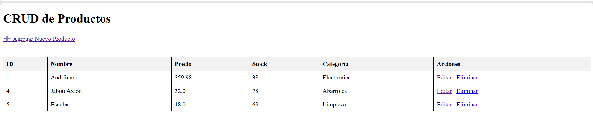
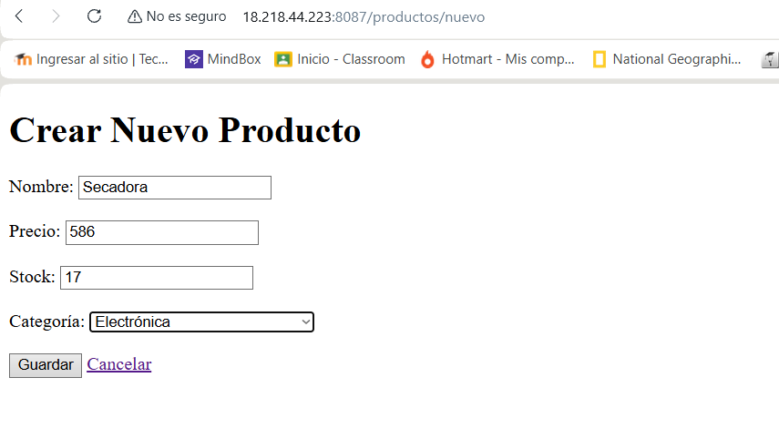
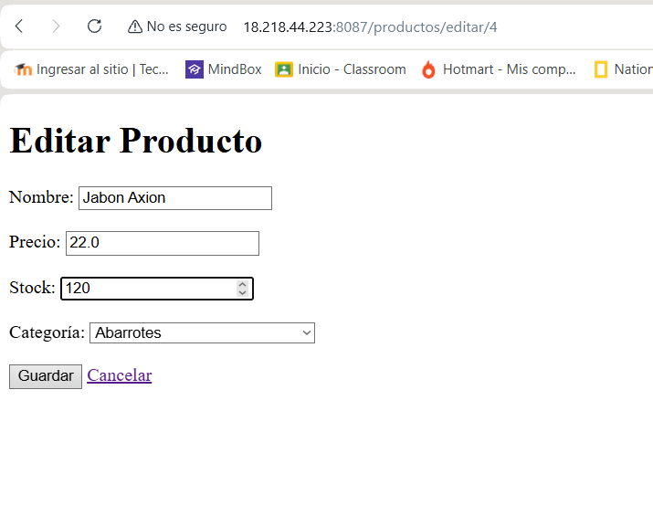
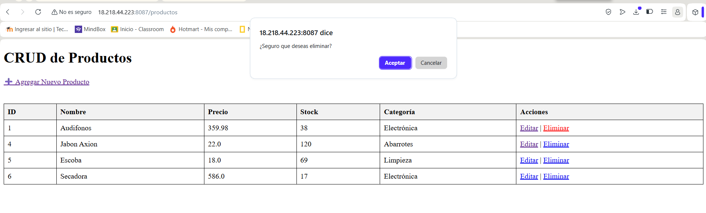
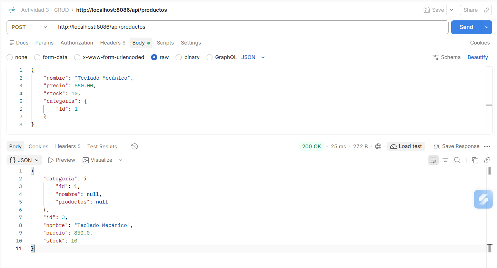
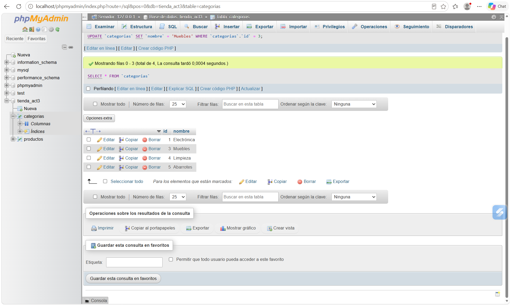

# Actividad 3: CRUD en Spring Boot y Relaciones con JPA

*   **Ruíz Jiménez Erandi Camila**

## Objetivo de la Práctica
Construir un CRUD completo en Spring Boot conectado a una base de datos real (MySQL/MariaDB), implementando al menos una relación entre entidades utilizando JPA, y probándolo tanto con vistas propias (Thymeleaf) como con peticiones REST (Postman). Todo desplegado en un VPS.

## Tecnologías Utilizadas
*   **Lenguaje:** Java 21
*   **Framework:** Spring Boot (v4.1.2)
*   **Persistencia:** Spring Data JPA (Hibernate)
*   **Base de Datos:** MariaDB / MySQL
*   **Motor de Plantillas:** Thymeleaf
*   **Cliente REST:** Postman
*   **Servidor:** AWS EC2 (Amazon Linux 2023)
*   **Herramientas:** Maven, VS Code.

## Arquitectura y Estructura del Proyecto
El proyecto sigue el patrón de diseño MVC (Modelo-Vista-Controlador) con una separación clara en capas para mantener un código limpio y escalable:

1.  **Models (Entidades):** 
    *   `Categoria.java`: Representa la tabla de categorías. Tiene una relación `@OneToMany` con Producto.
    *   `Producto.java`: Representa la tabla de productos. Tiene una relación `@ManyToOne` con Categoria, generando la llave foránea `categoria_id`.
2.  **Repositories:** Interfaces que extienden de `JpaRepository` (`CategoriaRepository` y `ProductoRepository`) para la comunicación con la base de datos, evitando escribir SQL manual.
3.  **Services:** Capa de lógica de negocio (`CategoriaService` y `ProductoService`) que interactúa con los repositorios.
4.  **Controllers:** 
    *   `ProductoController.java`: Controlador MVC que atiende las peticiones del navegador y devuelve las vistas HTML.
    *   `ProductoRestController.java`: Controlador REST que atiende peticiones JSON (usado para Postman).
5.  **Views (Thymeleaf):** Archivos HTML (`lista_productos.html` y `formulario_producto.html`) para la interacción visual del usuario.

---

## Evidencias del CRUD (Fase 1 y 2)

### 1. Listado de Productos (Leer)
Vista que muestra la tabla con los productos y el nombre de su categoría.

### 2. Crear Producto (Crear)
Formulario para dar de alta un nuevo producto.

### 3. Editar Producto (Actualizar)
Formulario que carga los datos del producto seleccionado para su modificación.

### 4. Eliminar Producto (Eliminar)
Eliminación del producto directamente desde la tabla.

### 5. Prueba de API REST en Postman
Petición POST exitosa al endpoint `/api/productos` enviando un JSON con los datos del producto y su categoría, recibiendo un `200 OK`.
*(Nota: No se pudo exportar la colección por restricciones de la versión de escritorio de Postman).*

### 6. Base de Datos (Relación)
Captura de la base de datos

---

## Despliegue en el VPS

El proyecto fue desplegado de forma independiente para no afectar las entregas anteriores.
1.  Se instaló MariaDB en el servidor (AWS EC2) y se creó la base de datos `tienda_act3`.
2.  Se configuró un perfil de producción (`application-prod.properties`) con las credenciales del servidor.
3.  Se generó el archivo `.jar` y se ejecutó en el **puerto 8087** usando `nohup`.

*   **Actividad 1:** Corriendo en el puerto 8081.
*   **Actividad 2:** Corriendo en el puerto 8084.
*   **Actividad 3:** Corriendo en el puerto 8087.

---

## Enlaces de Entrega
*   **Repositorio de GitHub:** [https://github.com/camicrts5-hash/ECRJact3_t4](https://github.com/camicrts5-hash/ECRJact3_t4)
*   **Proyecto en VPS (Actividad 3):** [http://18.218.44.223:8087/productos](http://18.218.44.223:8087/productos)
*   **Proyecto Actividad 1:** [http://18.218.44.223:8081/detalle_info2](http://18.218.44.223:8081/detalle_info2)
*   **Proyecto Actividad 2:** [http://18.218.44.223:8084/tienda/productos](http://18.218.44.223:8084/tienda/productos)
